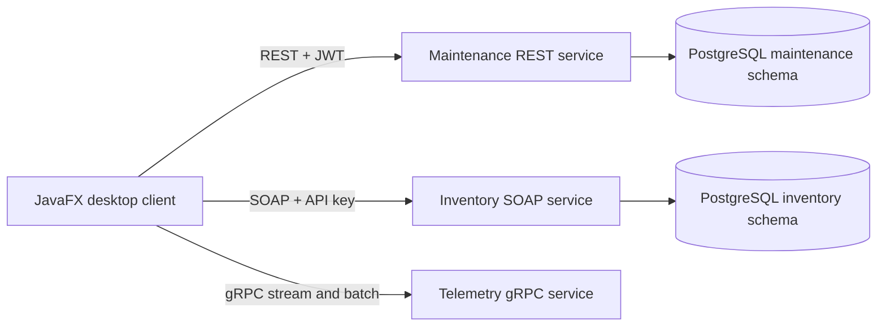
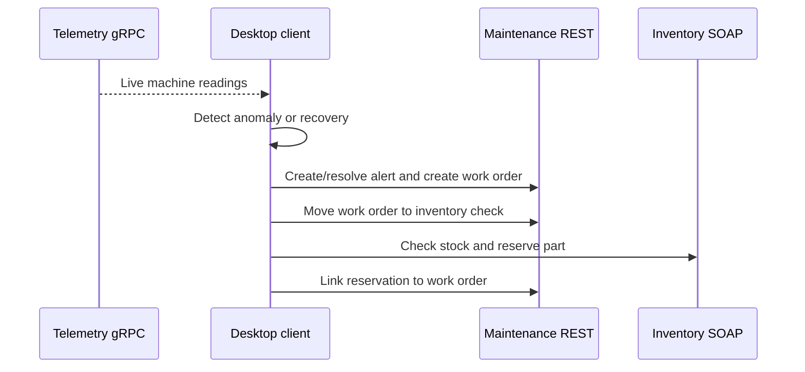

# SOA Project
### Industrial Monitoring & Predictive Maintenance System

A service-oriented industrial monitoring platform built with **Java 21, Spring Boot, REST, SOAP, gRPC, and JavaFX**.

SOA Project demonstrates how heterogeneous services collaborate to monitor industrial machines, process telemetry, detect abnormal conditions, manage maintenance alerts, and coordinate spare-part availability.

### Key Capabilities

- Industrial machine management, telemetry ingestion, and abnormal-condition detection.
- Maintenance alerts, work orders, and lifecycle transitions.
- Spare-part availability checks, inventory, and reservations.
- JWT authentication and role-based access control.
- REST, SOAP, and gRPC service integration.

## Architecture

The application has three backend services and a JavaFX desktop client:

| Component | Technology | Responsibility | Default address |
|---|---|---|---|
| Maintenance Service | Spring Boot, REST | Machines, authentication, alerts, and work orders | `http://localhost:8081` |
| Inventory Service | Spring Boot, SOAP | Spare parts, stock, and reservations | `http://localhost:8082/services/inventory` |
| Telemetry Service | gRPC | Machine readings and telemetry | `localhost:9090` |
| Desktop Client | JavaFX | User interface and service integration | — |
| Database | PostgreSQL | Backend persistence | `localhost:${DB_PORT}` |

The standard desktop launch opens the authenticated, live operations interface.
The UI's demo mode is an optional developer simulation, not the default
experience.





Telemetry is currently simulator-backed and held in memory: batch readings
update the live snapshot and active streams, but are not stored as historical
records. The desktop coordinates the alert/work-order/inventory flow; there is
no distributed transaction or durable retry queue across the REST and SOAP
services. A failed cross-service step is reported in the client and may need
operator reconciliation.

### Technology Stack

| Category | Technologies |
|---|---|
| Programming Language | Java 21 |
| Backend Framework | Spring Boot 3 |
| Security | Spring Security, JWT |
| Communication | REST, SOAP, gRPC |
| Desktop Application | JavaFX |
| Database | PostgreSQL |
| Build Management | Maven |
| API Documentation | Static OpenAPI specification |
| Testing | JUnit 5, Spring Boot Test, Testcontainers |
| Infrastructure | Docker, Docker Compose |

## Project Structure

```text
SOAProject/
├── maintenance-service/       # REST API and JWT authentication
├── inventory-soap-service/    # SOAP inventory API
├── frontend/
│   ├── pom.xml                # Frontend Maven reactor
│   ├── telemetry-contract/    # Shared gRPC/protobuf contract
│   ├── telemetry-service/     # gRPC server
│   ├── desktop-client/        # JavaFX application
│   └── contracts/grpc/        # Protobuf source
├── docker/
│   └── postgres/init/         # Database roles and schemas
├── docs/                      # API and integration documentation
├── docker-compose.yml
├── .env.example
├── pom.xml                    # Backend Maven reactor
└── README.md
```

The root `pom.xml` builds the REST and SOAP backend modules. The telemetry
contract, gRPC service, and JavaFX client are built from the separate
`frontend/pom.xml` reactor.

## Run the Full Project

### Prerequisites

Install JDK 21, Apache Maven, Docker with the Compose plugin, and Git. A
graphical desktop session is required to display the JavaFX client.

Verify Java and Maven use Java 21:

```bash
java -version
mvn -version
docker --version
docker compose version
```

### 1. Get the code and configure `.env`

Clone the repository and enter its root directory:

```bash
git clone https://github.com/Oussema-gif/SOAProject.git
cd SOAProject
```

Create the local environment file, then edit it with your own values:

**Linux (Bash)**

```bash
cp .env.example .env
${EDITOR:-nano} .env
```

**Windows (PowerShell)**

```powershell
Copy-Item .env.example .env
notepad .env
```

Set strong, private values in `.env`. In addition to the database settings
already listed in `.env.example`, add:

```text
JWT_SECRET=<base64-encoded random secret with at least 32 decoded bytes>
ADMIN_USERNAME=<your-login-name>
ADMIN_PASSWORD=<your-strong-password>
```

`JWT_SECRET` and `ADMIN_PASSWORD` must be set to start the REST service.
`ADMIN_USERNAME` selects the login name and defaults to `admin` if omitted.
Generate a JWT secret with OpenSSL on Linux:

```bash
openssl rand -base64 32
```

Or generate one in PowerShell:

```powershell
$bytes = New-Object byte[] 32
$rng = [System.Security.Cryptography.RandomNumberGenerator]::Create()
$rng.GetBytes($bytes)
[Convert]::ToBase64String($bytes)
$rng.Dispose()
```

Set a private `INVENTORY_API_KEY` as well. The SOAP service and the desktop
client read this variable from the environment, and both must use the same
value or SOAP requests will be rejected. Do not put key material in this
README or commit it. The `.env` file is local and must remain untracked.

### Clean install and verify

From the repository root, build, test, and install both independent Maven
reactors:

```bash
mvn clean install
mvn -f frontend/pom.xml clean install
```

The root reactor contains the REST and SOAP services. The frontend reactor
contains the telemetry contract, gRPC service, and desktop client; installing
it makes the shared contract available to the standalone `-pl` run commands
below. The `install` lifecycle runs the tests as well.

### 2. Start or reuse PostgreSQL

The Compose file publishes PostgreSQL on `127.0.0.1:${DB_PORT}` and defaults
`DB_PORT` to `5432`. First check whether a database container is already
running:

```bash
docker ps --filter name=soa-postgres --format "table {{.Names}}\t{{.Status}}\t{{.Ports}}"
```

If `soa-postgres` is already healthy, reuse it rather than starting Compose:
`docker-compose.yml` fixes the container name to `soa-postgres`, so
`docker compose up` will conflict with a container of that name. Set `DB_PORT`
in `.env` to the host port that the existing container publishes. For example,
if its port mapping is `127.0.0.1:5434->5432/tcp`, set `DB_PORT=5434`. The
backend must use the same host port.

If there is no existing `soa-postgres` container, start the project database:

```bash
docker compose up -d postgres
docker compose ps
```

Wait for PostgreSQL to report `healthy` before starting the services. If the
container exists but is unhealthy, inspect it with `docker logs soa-postgres`
instead of trying to create a second container with the same name.

### 3. Load `.env` and start the backend services

Start each service in its own terminal from the repository root. Load `.env`
again in every backend or desktop terminal that needs its values; environment
variables set in one terminal are not automatically available in another.

**Linux (Bash), in each backend or desktop terminal**

```bash
set -a
source ./.env
set +a
```

**Windows (PowerShell), in each backend or desktop terminal**

```powershell
Get-Content .env | ForEach-Object {
    if ($_ -match '^\s*([^#\s][^=]*)=(.*)$') {
        [Environment]::SetEnvironmentVariable($matches[1].Trim(), $matches[2].Trim(), 'Process')
    }
}
```

The PowerShell snippet imports the simple `KEY=value` lines in `.env` into
that terminal's process environment.

Run these commands in separate terminals; the Maven commands are the same in
Bash and PowerShell:

**Maintenance REST service** — `http://localhost:8081`

```bash
mvn -pl maintenance-service spring-boot:run
```

**Inventory SOAP service** — `http://localhost:8082/services/inventory`

```bash
mvn -pl inventory-soap-service spring-boot:run
```

**Telemetry gRPC service** — port `9090`

Start telemetry in its own terminal:

```bash
mvn -f frontend/pom.xml -pl telemetry-service exec:java
```

### 4. Launch the JavaFX client

Start the REST, SOAP, and gRPC services first. In a separate terminal, load
`.env` using the Bash or PowerShell commands above so the client receives
`INVENTORY_API_KEY`, then launch the JavaFX application from the repository
root:

```bash
mvn -f frontend/pom.xml -pl desktop-client org.openjfx:javafx-maven-plugin:0.0.8:run
```

Log in with the `ADMIN_USERNAME` (default `admin`) and `ADMIN_PASSWORD`
configured in `.env`. The client uses REST on port `8081`, SOAP on `8082`, and
gRPC on `9090`.

The normal launch is the authenticated, live operations UI. To preview the
interface in its simulated developer demo mode without starting backend or
database services:

**Linux (Bash)**

```bash
KT_DEMO=true mvn -f frontend/pom.xml -pl desktop-client org.openjfx:javafx-maven-plugin:0.0.8:run
```

**Windows (PowerShell)**

```powershell
$env:KT_DEMO = 'true'
mvn -f frontend/pom.xml -pl desktop-client org.openjfx:javafx-maven-plugin:0.0.8:run
Remove-Item Env:KT_DEMO
```

The desktop client also supports demo mode with the `--demo` argument when
launched directly.

`docs/demo-workflow.sh` is a Bash script for the REST/SOAP workflow and requires
the backend services, PostgreSQL, and the relevant environment variables:

```bash
set -a
source ./.env
set +a
bash docs/demo-workflow.sh
```

### Troubleshooting

- **Login is rejected:** Confirm the REST service is running on port `8081`,
  both admin variables are set in its terminal, and the credentials entered
  match them exactly.
- **Database connection fails:** Confirm the container is healthy and
  `DB_PORT` in `.env` matches its published host port. Use `docker ps` and
  `docker logs soa-postgres` to inspect it.
- **Port is already in use:** Check listeners with
  `ss -ltnp` (Linux) or
  `Get-NetTCPConnection -State Listen -LocalPort 5432,5434,8081,8082,9090`
  (PowerShell). Stop the conflicting service or configure the database host
  port consistently in `.env`.
- **SOAP inventory calls are rejected:** Check that the server-side API key
  matches the key currently configured in the desktop client. Never paste the
  key into public documentation or commit it.

## API & Integration Documentation

The `docs/` directory contains the REST API specification, SOAP examples,
integration contract, Postman collection, and Bash demo workflow.

## Security

Keep `.env`, database credentials, JWT secrets, and API keys out of version
control. The `.env.example` file contains placeholders only; replace them
locally before running services.

## Academic Objectives

This project demonstrates service independence, loose coupling,
interoperability, heterogeneous communication protocols, distributed
application architecture, service orchestration, database integration, and
secure service communication.

## Authors

**Oussema Rahmouni** — Backend Engineering & Enterprise Services

**Houssem Mosbeh** — Desktop Application & Frontend Integration

## License

Developed for academic and educational purposes.
